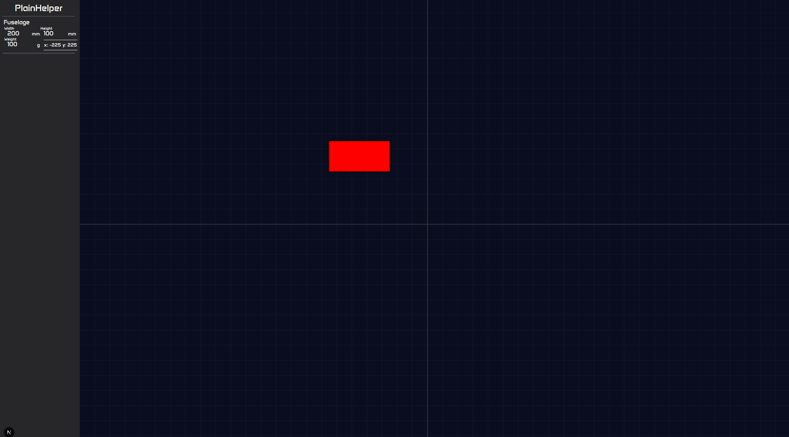

# PlainHelper

I need some site to help me with my fuckass CG calculations that always turn out just a tiny bit more complicated than id want to think about, and the sites available just arent doing it for me, so im making my own!

# Week 1 Progress

So, this is my Progress after working ~4h on this over the last week! I havent had too much time this week because of a huge hackathon and last-year exams, so this is kiiiinda incomplete :/

So far weve got:

- "Fuselage" dragging around the canvas (fuselage in question is a resizeable red brick rn)
- Width, Length and Weight setting of the Fuselage
- Snapping to a drawn grid, resizes even on window resize, so thats nice ig
- X and Y coord display

# Tech Stack

Whole thing is in nextjs!

